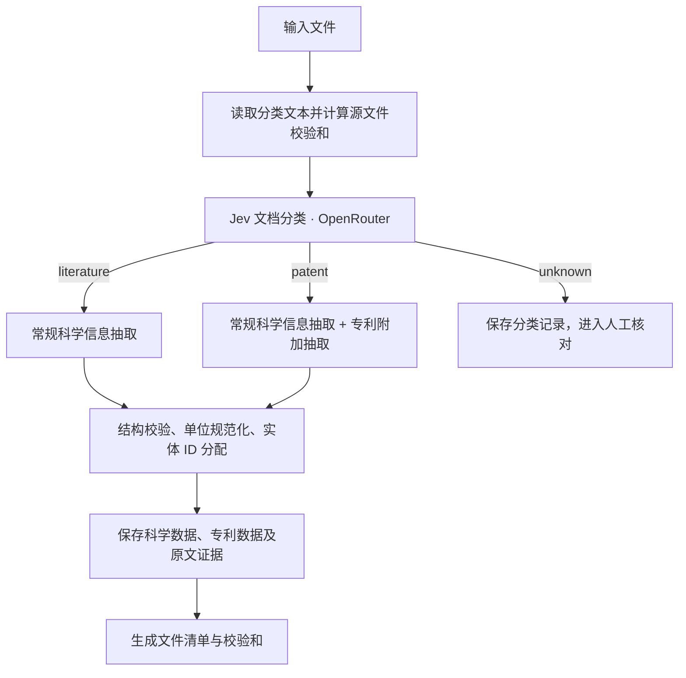

# Data Agent 专利抽取设计与测试方案

## 第一部分：设计方案

### 1. 目标

Data Agent 接收文件后，先由 Jev 判断文档类型，再执行抽取。文献和专利都进入现有科学信息抽取流程；专利额外提取文献信息、权利要求（Claim）、序列、保护对象和限制条件。

抽取结果同时回答三个问题：

1. 文件披露了哪些 Binder、CAR、制造工艺及实验结果？
2. 这份专利的各条 Claim 定义了什么对象，包含哪些条件？
3. 每项信息来自原文哪里，Claim 与科学实体如何关联？

### 2. 数据组织

专利采用独立的 [Schema_Patent.yaml](Schema/Schema_Patent.yaml)。Binder、CAR 和制造工艺继续使用各自的 Schema。

专利记录以“具体文献及其 Claim 版本”为单位。公开文本、授权文本和修改文本各自保存版本信息；专利家族通过成员公开号建立联系。Claim 编号和 SEQ ID NO 在所属文献版本内解析。

| 数据层级 | 记录单位 | 主要内容 |
| --- | --- | --- |
| 专利文献 | 一份具体文献及其 Claim 版本 | 公开号、申请号、授权号、司法辖区、家族、法律状态 |
| Claim | 本版本的一条权利要求 | 编号、完整原文、独立或从属类型、直接依赖关系 |
| 保护对象 | 一条 Claim 中的一个对象定义 | 对象类型、名称、组成或结构、功能 |
| 限制条件 | 一条 Claim 直接写出的一个条件条款 | 条件类别、完整文字、适用对象、参考序列和定义 |
| 序列 | 本版本的一个 SEQ ID NO | 序列编号、序列内容及来源信息 |
| 实体关联 | 专利与一个科学实体之间的一项关系 | 实体类型、实体 ID、关系类型及原文依据 |
| 原文定位 | 一个字段或数组项的证据位置 | 字段路径、来源文件、页码或段落等位置、原文片段 |

保护对象覆盖 Binder、CAR、细胞、核酸、载体、组合物、用途和制备方法等。具体对象与泛化对象定义都保存在 `claims[].protected_subject_matter`，由 `subject_type` 标明类型。

这一组织方式支持一份专利包含多类对象，也支持同一个 Binder、CAR 或制造工艺关联多份专利。

### 3. 处理流程

Jev 负责文档级分类，Data Agent 负责字段级抽取，程序负责结构校验、ID 分配和结果保存。

#### 3.1 文件读取与分类输入

分类对象是当前输入文件。文件转换为可读文本后，按以下规则构建分类输入：

- 文本长度在 24,000 字符以内时，使用全文。
- 超过 24,000 字符时，使用开头和结尾各 12,000 字符，覆盖文献首页信息及结尾内容。
- PDF 文本附带 PDF 页序标签；扫描件先完成 OCR。
- XML 保留原始元数据。

分类记录保存文本哈希、总字符数、摘录内容及其字符位置。抽取 Agent 随后读取源文件完成抽取。

#### 3.2 Jev 分类与调用配置

通过 OpenRouter Decisions API 调用 Jev，使用一个 `choice` 问题输出文档类别：

| 类别 | 定义 | 后续动作 |
| --- | --- | --- |
| `literature` | 科学论文、综述、预印本及可识别的补充材料 | 执行常规科学信息抽取 |
| `patent` | 专利公开、申请、授权文本及可识别的 Claim 或序列表附件 | 执行常规科学信息抽取，并增加专利抽取 |
| `unknown` | 内容类型待确认、混合文档或识别信息不足 | 保存分类结果和诊断，交由人工核对 |

分类依据是文件自身的身份、出版元数据和内容结构。论文中讨论专利时仍归为文献；专利引用论文时仍归为专利。

所有 OpenRouter 调用统一读取 `OPENROUTER_API_KEY`。Jev 模型通过 `CART_JEV_MODEL` 配置，当前默认值为 `typesafe/jev-1.14`。Codex 使用 OpenRouter 端点时，由 runner 将同一个 key 传入其接口认证环境。

分类请求、模型响应、类别概率、置信度、模型标识、token 用量和返回费用保存到 `document_classification.json`。认证凭据保留在运行环境中。

#### 3.3 常规科学信息抽取

文献与专利采用相同的科学信息抽取要求，提取 Binder、CAR、制造工艺、组合关系及实验依据。专利说明书中的对象定义、实施例、实验结果和图表均作为科学信息来源。

图表继续使用现有提取流程，生成图片文件和 `figures.jsonl`，并与结构化数据一起发布。

#### 3.4 专利附加抽取

| 信息模块 | 抽取内容 | 组织方式 |
| --- | --- | --- |
| 文献身份 | 公开号、申请号、授权号、司法辖区、Claim 版本 | 专利记录顶层字段 |
| 专利家族 | 家族标识、来源、定义和成员公开号 | `patent_family` |
| 法律状态 | 来源报告的状态或事件、生效日期、状态截至日期、实际查询日期 | `legal_status`，每项对应一条状态或事件 |
| Claim 正文 | 编号、独立或从属类型、完整文字、直接引用的父 Claim | `claims` |
| Claim 序列引用 | 本条直接引用的 SEQ ID NO | `claims[].seq_id_nos`，连接本版本的 `sequences` |
| 保护对象 | 对象定义、组成或结构、功能及用途表述 | `claims[].protected_subject_matter` |
| 限制条件 | 序列同一性、相似度、CDR、表位、结构、功能、组成、用途及工艺条件 | `claims[].limitations` |
| 原文依据 | 字段路径、来源和可复定位位置、原文片段 | `source_locations` |
| 待补信息 | 缺页、缺少序列表、引用待解析、内容冲突及受影响字段 | `extraction_issues` |

每条 Claim 保留自己的完整文字和直接条件。父 Claim 通过 `depends_on` 连接，原始依赖表达保存在 `dependency_text`。后续读取时沿依赖关系取得继承条件，并结合原文中的“任一项”、AND、OR 等表达解释组合关系。

序列限制同时记录阈值、比较符、适用区域、参考 SEQ ID NO，以及来源说明的计算方法或编号体系。例如，针对 VH 的一致性条件，其 `applies_to` 明确记录为 VH。

来源尚未提供的字段使用 `null`；核对完整来源后确认集合为空时使用 `[]`。缺失内容及对应位置写入 `extraction_issues`，支持补充材料后的定向复核。

### 4. 专利与科学实体的关联

`entity_links` 连接当前抽取结果中的 Binder、CAR 和制造工艺实体，关系分为两类：

| 关系 | 含义 | 定位信息 |
| --- | --- | --- |
| `disclosed_in_description` | 说明书披露了该实体 | 实体 ID、披露依据和原文位置 |
| `explicitly_defined_in_claim` | Claim 明确定义了该实体 | 实体 ID、Claim 编号、保护对象下标、定义依据和原文位置 |

细胞、核酸、载体、组合物和用途等对象直接保存在 Claim 的保护对象数组中。已有科学实体通过关联字段连接。

Agent 使用文档内的局部 ID 表达引用。程序统一分配 UUID，并同步改写科学数据和专利关联中的引用，使两组输出使用一致的实体标识。

`claim_scope_assessments` 用于后续候选与 Claim 的条件匹配分析。本阶段产出原文事实，该字段值为 `null`。

### 5. 校验与结果保存

校验在科学记录和专利记录合并的草稿上执行，随后分别保存结果：

1. 按 YAML 检查字段、类型、必填项和枚举值。
2. 检查 Claim 编号和 SEQ ID NO 的唯一性。
3. 检查实体关联目标，以及 Claim 关联中的编号、对象下标和对象类型。
4. 对专利分类结果检查专利记录是否存在，对文献分类结果检查输出表类型。
5. 完成单位规范化、UUID 分配及引用改写。
6. 校验图表产物，生成文件清单和校验和，发布结果。

| 产物 | 内容 | 使用方式 |
| --- | --- | --- |
| `document_classification.json` | Jev 分类请求、响应、源文件哈希和费用 | 复核分类与统计调用消耗 |
| `data.jsonl` | 规范化后的科学记录 | 进入现有科学数据入库流程 |
| `original.jsonl` | Agent 输出的原始科学记录 | 对照规范化前后的内容 |
| `patent.jsonl` | 规范化后的专利附加记录 | 按专利、Claim、序列和实体关联检索核对 |
| `patent.original.jsonl` | Agent 输出的原始专利记录 | 对照专利字段及引用改写 |
| `reasoning.md` | 抽取依据和记录说明 | 支持人工复核 |
| `figures.jsonl`、`img/` | 图表清单和图片文件 | 查看图表证据 |
| `source_manifest.json` | 源文件、Schema 和产物的校验信息 | 校验结果一致性与续跑条件 |

当前专利数据以独立 JSONL 文件随文档保存，并作为附属上下文进入现有流程。科学数据沿用现有关系表。

输出修正复用本次分类结果。分类费用与抽取费用共同计入文档消耗；调用失败或分类待确认时保存诊断。正常续跑校验分类记录、源文件与产物，补图流程复用已有抽取结果。

### 6. 数据流示例

假设一份专利的说明书披露 Binder A 和一个细胞制备工艺，Claim 1 定义一类结合蛋白并引用 SEQ ID NO: 7，Claim 2 引用 Claim 1 并增加结构条件。

| 步骤 | 输入与处理 | 结果 |
| --- | --- | --- |
| 分类 | Jev 读取该文件的分类文本，判断为 `patent` | 保存分类记录，启动科学信息和专利信息抽取 |
| 科学抽取 | 读取 Binder A、制备工艺及实验结果 | 形成 Binder、manufacturing 及相应证据记录 |
| Claim 抽取 | 逐条保存 Claim 1、Claim 2 的正文和直接条件 | Claim 2 的 `depends_on` 包含 Claim 1 的编号 |
| 序列关联 | 读取 SEQ ID NO: 7 的序列条目 | Claim 1 的引用连接本版本序列表 |
| 实体关联 | 根据说明书的披露位置关联 Binder A | 创建 `disclosed_in_description` 关系及证据位置 |
| 结果保存 | 校验合并草稿，分配 UUID 并改写引用 | 科学记录保存到 `data.jsonl`，专利记录保存到 `patent.jsonl` |

人工核对时，可以从一条 Claim 查看其正文、直接条件、父 Claim 和引用序列，也可以从一个科学实体找到关联专利及对应的原文依据。
